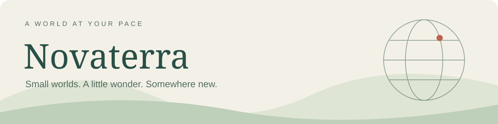
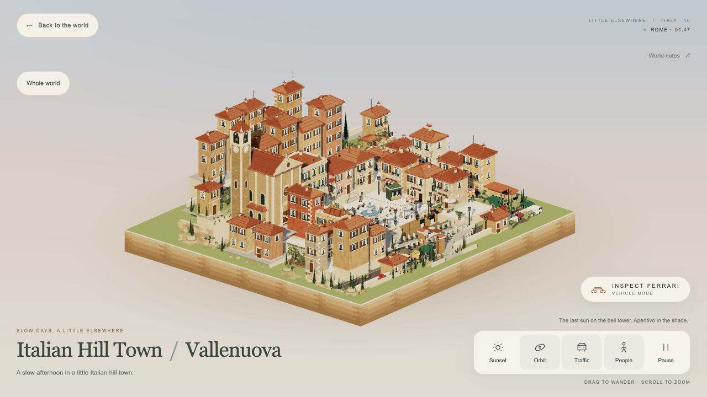

<div align="center">



**Interactive miniature worlds, made for wandering.**  
**在微缩世界里，慢慢发现远方。**

Formerly Little Elsewhere · 原 Little Elsewhere

[](https://little-elsewhere-vance.chenvance.chatgpt.site/)

[Open the website · 直接进入网站](https://little-elsewhere-vance.chenvance.chatgpt.site/) · [Browse the worlds · 探索目的地](https://little-elsewhere-vance.chenvance.chatgpt.site/#destinations)

</div>

> **Public website / 正式网址：** [Novaterra — Explore the world](https://little-elsewhere-vance.chenvance.chatgpt.site/)  
> 无需下载或启动本地服务器，点击即可在浏览器中体验。网站当前仍显示 Little Elsewhere 品牌。

[](https://little-elsewhere-vance.chenvance.chatgpt.site/italy)

| Explore / 探索 | Stay a little / 慢一点 | Collect / 留下足迹 |
| :--- | :--- | :--- |
| Drag and zoom the globe to choose a destination. 拖动地球，寻找下一站。 | Discover miniature architecture, local details and animated everyday life. 看建筑、风景与日常。 | Revisit destinations through the passport and surprise draw. 用护照与随机探索开启旅程。 |

### A few places to begin · 从这里出发

| Destination | Visit | Destination | Visit |
| :--- | :--- | :--- | :--- |
| 🇯🇵 Japan / 日本 | [Harukaze Station](https://little-elsewhere-vance.chenvance.chatgpt.site/japan) | 🇨🇭 Switzerland / 瑞士 | [Alpine Village](https://little-elsewhere-vance.chenvance.chatgpt.site/switzerland) |
| 🇮🇹 Italy / 意大利 | [Vallenuova](https://little-elsewhere-vance.chenvance.chatgpt.site/italy) | 🇬🇱 Greenland / 格林兰 | [Coastal world](https://little-elsewhere-vance.chenvance.chatgpt.site/greenland) |
| 🇫🇷 France / 法国 | [Paris](https://little-elsewhere-vance.chenvance.chatgpt.site/france) | 🇰🇷 South Korea / 韩国 | [Seoul](https://little-elsewhere-vance.chenvance.chatgpt.site/korea) |

Each place has its own architecture, atmosphere and small interactions. Drag to orbit, scroll to zoom, and try the scene controls.  
每一个目的地都有自己的建筑、氛围和互动。拖动旋转、滚轮缩放，使用场景下方的控制栏。

Canada is developed separately in [standalone/canada/](standalone/canada/) and is not connected to the public website yet.  
加拿大目前保留为独立作品，尚未接入主站。

<details>
<summary><strong>For developers · 本地运行、源码与部署</strong></summary>

## Project source

Little Elsewhere is an interactive collection of miniature worlds. This repository contains the current website source, the shared destination pages, and the local preview server. The independently developed Canada scene is under `standalone/canada/`; it is not connected to the website yet.

## Run locally

Install Node.js 22.13 or newer, then run:

```sh
npm ci
npm run build
npm run dev
```

Open http://127.0.0.1:8766. The preview uses a local SQLite database under `work/`; local likes are independent of the live site's counts. Many scenes load Three.js from a CDN, so internet access is needed.

## Edit the project

- `dist/index.html`, `dist/app.js`, and the CSS files contain the home page and globe interface.
- `dist/*.html` contains the individual destination scenes; `dist/switzerland.html` includes the latest Swiss model and spatial fixes.
- `dist/world-shell.js` and `dist/world-shell.css` provide shared scene controls and presentation.
- `worker/`, `db/`, and `drizzle/` contain the likes API and database schema.
- `design/switzerland/` contains the Blender source for the mountain mesh and its generated vertex data. The rest of the village is generated by the webpage.
- `tests/` contains the automated checks. Run `npm test` after edits.

## London

`dist/london.html` integrates the supplied London After the Rain export as the United Kingdom destination (`uk`, map codes `GB` / `GBR`). It is available from the destination list, globe, passport and surprise draw. The scene bundles its Three.js modules; only the shared website shell is loaded alongside it. London local time uses `Europe/London`. Rain, Fog, Sunny and the original scene controls are retained. The shared likes API includes `uk`; deploy the updated worker with the page to enable its likes.

## Deployment

The included `.openai/hosting.json` uses a local placeholder rather than the original live site's identifier. For a new deployment, configure the hosting environment and a D1-compatible database. Static-only hosting will not provide shared likes. Do not commit credentials, personal databases, `node_modules/`, or deployment secrets.

Third-party notices are in `THIRD_PARTY_LICENSES.txt` and `dist/assets/`.

Italy / Vallenuova is now available at `/italy` and `/italy.html`. The editable scene and vendored Three.js modules are in `dist/assets/italy-worlds/`; the country shell uses `world-shell.*` and `italy-world.css`. Export an offline copy with `python3 scripts/export-italy.py /absolute/output/italy.html`. The scene is an imagined Italian hill town.


</details>

[Original README archive · 原始说明存档](docs/showcase/README-before-showcase-2026-11-02.md) · [Third-party notices](THIRD_PARTY_LICENSES.txt)

---

<div align="center">

**Somewhere new is one click away.**  
[Explore Novaterra →](https://little-elsewhere-vance.chenvance.chatgpt.site/)

</div>
